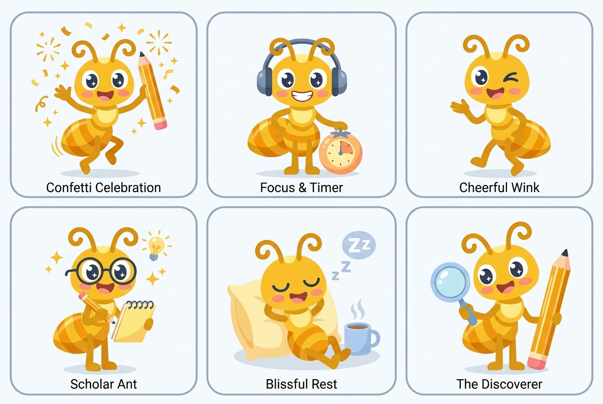

# Milo — The ANTs Brand Mascot Design Bible & Usage Guide

> **Official Name:** **Milo** (`ANT_MASCOT_NAME = 'Milo'`)  
> **Style:** Lighter Sunlit-Gold Playful Geometric Vector (Duolingo-inspired bold shapes, curled spiral antennae, oversized glossy eyes with 4-point star catchlights, honey-striped teardrop abdomen) evolved directly from The ANTs golden pencil-holding ant emblem.  
> **Personality:** Cozy, Warm, Positive & Lightly Cheeky Study/Focus Companion (never grumpy or harsh).  
> **Shared React Components:** `<AntMascot />` (`@ants/ui` · `packages/ui/src/views/AntMascotView.tsx`), `<MiloCompanionDock />` (`packages/ui/src/views/MiloCompanionDockView.tsx`), & `<NotFoundView />` (`packages/ui/src/views/NotFoundView.tsx`).  
> **Canonical Visual Reference Sheets:** [`assets/mascot-hero-sheet.jpg`](./assets/mascot-hero-sheet.jpg) · [`assets/mascot-expressions-grid.jpg`](./assets/mascot-expressions-grid.jpg)




---

## 1. Character Identity & Variants

Milo serves as the unified companion across **`the-ants.org`**, **`study.the-ants.org`**, **`flow.the-ants.org`**, and **`@TheANTsFlowBot`**.

- **`variant="full"` (Default):** Full-body geometric vector character with curled spiral antennae, 4-point star eye catchlights, honey-striped abdomen, and contextual props (`pencil`, `scholar`, `headphones`, `timer`, `bell`, `magnifier`, `pillow`, `none`).
- **`variant="avatar"`:** Compact rounded-squircle app-icon head badge matching the App Icon study in [`assets/mascot-hero-sheet.jpg`](./assets/mascot-hero-sheet.jpg), ideal for compact headers, inline banners, Telegram previews, and mobile summary bars.
- **Interactive Tap Delight (`interactive`):** Renders Milo inside an accessible button that plays a crisp `380ms` spring hop (`ants-mascot-hop`) and cycles optional `tapLines` quips when clicked.

---

## 2. Visual System & Color Harmony

Designed to pop crisply on both **Light Mode** (`#f8fafc` Slate canvas) and **Dark Mode** (`#0B0C0E` Obsidian canvas):

| Part | Hex | Role |
| :--- | :--- | :--- |
| **Body & Head Primary** | `#FBBF24` | Sunlit Gold (Amber 400) — bright, energetic, upbeat on Light & Dark |
| **Abdomen & Limbs Shade** | `#F59E0B` / `#D97706` | Warm Honey (Amber 500–600) — striped teardrop abdomen & curled antennae |
| **Highlights & Wood Tip** | `#FEF08A` / `#FEF3C7` | Buttercream glow — fresh cartoon crown, belly, and pencil wood cone |
| **Eyes & Pupils** | `#FFFFFF` + `#1E293B` | Oversized glossy eyes with 4-point star catchlights |
| **Pencil Eraser & Cheeks** | `#FDA4AF` / `#FB7185` | Warm rosy peach-coral accent & cheerful tongue |
| **Headphones / Glasses / Rim** | `#334155` / `#475569` | Slate 700/600 — crisp contrast for props |

---

## 3. Signature Props & Ecosystem Touchpoints (Companion Dock + Earned Moments)

Milo combines a **collapsible corner companion dock (`<MiloCompanionDock />`)** across all 3 apps with contextual inline moments—staying unobtrusive while cheering real user milestones:

- **Draggable Borderless Corner Companion (`<MiloCompanionDock />` · `ants-milo-companion-v1`):**
  - Mounted via `<OrgMiloDockView />`, `<StudyMiloDockView />`, and `<FlowMiloDockView />` in each app's root `layout.tsx` (automatically offset above mobile sticky navs and hidden on `/cms`, `/admin`, `/login`, `/signup`).
  - Renders unified **borderless full-body Milo** (`variant="full"` with warm ambient amber aura) across both desktop and mobile near bottom-right, with eye-blinking (`ants-mascot-blink`), buoyant idle sway (`ants-mascot-companion-idle`), tap sparkle/heart bursts (`ants-mascot-burst`), and playful drag wiggle (`ants-mascot-drag-wiggle`).
  - Tap Milo to hop (`ants-mascot-hop`) and cycle route-aware tips, drag freely anywhere to soft-snap left/right (`localStorage` persisted, auto-flipping speech bubble), or double-tap / minimize to reset; includes Quiet (`BellOff`) and Minimize (`Minus`) controls.
  - **Real Achievement Reactions (`emitMiloCheer` / `ANTS_MILO_CHEER_EVENT`):** Auto-pops a 4.2s celebratory bubble when you finish a Pomodoro work sprint, check off a task (`TaskPlannerView`) or timetable block (`SmartTimetableView`), log a Study daily revision check-in (`StudyDashboardView`), master a syllabus topic (`StudyTopicTrackerView`), log a past paper (`StudyPastPapersView`), clear due flashcards (`StudyFlashcardsView`), submit a quiz (`StudyQuizzesView`), or save a Grade Calculator snapshot (`GradeCalculatorView`).

| App / Surface | Component / Route | Milo Configuration | Role |
| :--- | :--- | :--- | :--- |
| **`@ants/ui` Auth & Gate** | `AuthStudioView`, `WorkspaceAuthGateView` | `variant="avatar"`, `mood="happy" \| "nudge" \| "idle"` | Welcomes returning learners and softens guest gates |
| **`@ants/ui` Telegram** | `TelegramConnectCardView` | `mood="nudge"` + `propVariant="bell"`, avatar in ping preview | Guides `@TheANTsFlowBot` linking & ping checks |
| **404 Recovery (`*`)** | `<NotFoundView />` (`apps/{org,study,flow}/src/app/not-found.tsx`), `UserProfileView` missing `@[handle]` fallback | `mood="curious"`, `propVariant="magnifier"`, `interactive` + `tapLines` | Warm route & missing-handle recovery across all 3 apps |
| **Flow (`flow.the-ants.org`)** | `PomodoroView`, `FocusModeView`, `TaskListView`, `PomodoroStatsView`, `TaskPlannerView`, `TodayFocusRailView`, `TelegramReminderModalView` | Reactive `focus`/`curious`/`happy`/`sleeping` (`headphones`/`pillow`), empty states (`magnifier`/`pencil`), Telegram ping avatar | Live focus companion without overflowing 1-screen timer card |
| **Study (`study.the-ants.org`)** | `StudyDashboardView`, `StudyFlashcardsView`, `StudyQuizzesView`, `StudyCurriculumCatalogView`, `StudyTopicTrackerView`, `StudyPastPapersView`, `StudyNotesView`, `StudyCountdownView`, `StudyLeaderboardView` | Streak spotlight (`scholar`), Deck Cleared celebration, Quiz score-band companion, empty/filter states (`magnifier`/`scholar`) | Celebrates real milestones and clarifies empty/filtered states |
| **Org (`the-ants.org`) & `@ants/calculator`** | `OrgHomeLandingView`, `OrgFooterView`, `OrgTeamShowcaseView`, `OrgActivitiesView`, `OrgArticlesView`, `GradeCalculatorView` | Orbit telemetry node-reactive companion, subtle footer avatar, empty-search states (`magnifier`), reactive Grade Calculator result companion | Connects showcase tools warmly while keeping photography clean |

---

## 4. Voice, Tone & Microcopy Guidelines

**Do:** Warm, supportive, lightly cheeky, proud of small consistent habits (*"Small daily habits, colony-sized results"*).  
**Don't:** Harsh, guilt-heavy, robotic, or cluttered with walls of text. Keep speech bubbles under **12–15 words**.

### Ready-to-Use Presets (`ANT_MASCOT_PRESETS`)

```tsx
import { ANT_MASCOT_NAME, AntMascot, ANT_MASCOT_PRESETS } from '@ants/ui';

// 1-line preset drop-in:
<AntMascot {...ANT_MASCOT_PRESETS.studyStreak} size="md" interactive />

// Compact app-icon badge variant:
<AntMascot variant="avatar" size={40} mood="happy" app="flow" interactive ariaLabel="" />

// Custom usage:
<AntMascot
  mood="focus"
  app="flow"
  size="lg"
  speech="Headphones on. 25 minutes of pure Flow—Milo’s guarding the clock."
  badge="25:00 Focus"
/>
```

---

## 5. Accessibility & Motion Rules

- All animations (`ants-mascot-float`, `ants-mascot-celebrate`, `ants-mascot-antenna`, `ants-mascot-zzz`, `ants-mascot-sparkle`, `ants-mascot-hop`, `ants-mascot-blink`, `ants-mascot-companion-idle`, `ants-mascot-drag-wiggle`, `ants-mascot-burst`) are automatically disabled under `@media (prefers-reduced-motion: reduce)`.
- Pass `ariaLabel=""` when Milo is purely decorative next to equivalent visible text so screen readers do not announce redundant descriptions.
- Never nest `<AntMascot interactive />` inside another `<button>` or `<a>` element.
