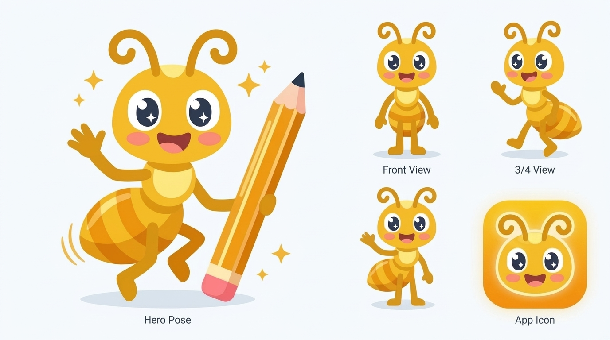

# The ANTs Brand Mascot — Design Bible & Usage Guide

> **Style:** Lighter Sunlit-Gold Playful Geometric Vector (Duolingo-inspired bold shapes, oversized expressive starry eyes, bendable antennae) evolved directly from The ANTs golden pencil-holding ant emblem.  
> **Personality:** Warm, Positive, Cheeky & Energetic Study Buddy (never grumpy or harsh).  
> **Shared React Component:** `<AntMascot />` (`@ants/ui` · `packages/ui/src/views/AntMascotView.tsx`).  
> **Canonical Visual Reference Sheets:** [`assets/mascot-hero-sheet.jpg`](./assets/mascot-hero-sheet.jpg) · [`assets/mascot-expressions-grid.jpg`](./assets/mascot-expressions-grid.jpg)




---

## 1. Character Identity & Name Proposals

The component API uses the neutral name `<AntMascot />` so you can finalize the character's public name at any time without refactoring code. Top 5 name candidates:

| Candidate | Vibe & Meaning | Why It Works |
| :--- | :--- | :--- |
| **1. Pip** *(Top Pick)* | Short, punchy, friendly ("Pip the Ant") | Feels like "Duo" — 1 syllable, memorable in notifications (*"Pip noticed your streak is cooling off!"*) and doubles as "pip" (a tiny seed/spark). |
| **2. Nib** | Pencil nib / ink tip | Directly honors the iconic oversized golden pencil from The ANTs logo. |
| **3. Otto** | Clever tiny scholar | Warm, approachable, slightly nerdy academic buddy. |
| **4. Milo** | Cozy study companion | Great for Pomodoro & Flow sessions (*"Focus with Milo"*). |
| **5. Zest** | Energetic amber spark | Matches the golden amber palette and upbeat streak celebrations. |

---

## 2. Visual System & Color Harmony

Designed to pop crisply on both **Light Mode** (`#f8fafc` Slate canvas) and **Dark Mode** (`#0B0C0E` Obsidian canvas):

| Part | Hex | Role |
| :--- | :--- | :--- |
| **Body & Head Primary** | `#FBBF24` | Sunlit Gold (Amber 400) — bright, energetic, upbeat on Light & Dark |
| **Abdomen & Limbs Shade** | `#F59E0B` / `#D97706` | Warm Honey (Amber 500–600) — friendly silhouette & stripes |
| **Highlights & Wood Tip** | `#FEF08A` / `#FEF3C7` | Buttercream glow — fresh, light cartoon depth |
| **Eyes & Pupils** | `#FFFFFF` + `#0F172A` | Oversized glossy eyes with lively twin catchlights |
| **Pencil Eraser & Cheeks** | `#FDA4AF` / `#FB7185` | Warm rosy peach-coral accent |
| **Headphones / Glasses** | `#334155` | Slate 700 — crisp editorial contrast |

---

## 3. Signature Props Across the Ecosystem

The **oversized golden pencil** is the mascot's core signature prop (linking directly back to The ANTs logo), while each product adds contextual accessories automatically via the `app` and `mood` props:

| App / Channel | Default `propVariant` | Visual Detail | Best Moods |
| :--- | :--- | :--- | :--- |
| **`the-ants.org` (`org`)** | `pencil` | Iconic golden pencil held diagonally | `happy`, `idle`, `curious` |
| **`study.the-ants.org` (`study`)** | `scholar` / `pencil` | Round scholar glasses + golden pencil | `studying`, `celebrating`, `curious` |
| **`flow.the-ants.org` (`flow`)** | `headphones` / `timer` | Sleek slate headphones (Focus) or mini clock (Break) | `focus`, `sleeping`, `happy` |
| **Telegram Bot (`telegram`)** | `bell` | Golden notification bell with crimson unread dot | `nudge`, `celebrating` |

---

## 4. Voice, Tone & Microcopy Guidelines

**Do:** Warm, supportive, lightly cheeky, proud of small consistent habits (*"Small daily habits, colony-sized results"*).  
**Don't:** Harsh, guilt-heavy, robotic, or cluttered with walls of text. Keep speech bubbles under **12–15 words**.

### Ready-to-Use Presets (`ANT_MASCOT_PRESETS`)

```tsx
import { AntMascot, ANT_MASCOT_PRESETS } from '@ants/ui';

// 1-line preset drop-in:
<AntMascot {...ANT_MASCOT_PRESETS.studyStreak} size="md" interactive />

// Custom usage:
<AntMascot
  mood="focus"
  app="flow"
  size="lg"
  speech="25 minutes of pure Flow—I’ll guard the clock."
  badge="25:00 Focus"
/>
```

| Touchpoint | Preset Key | Sample Line |
| :--- | :--- | :--- |
| **Study Streak / Mastery** | `studyStreak` | *"Streak secured! One past paper closer to that A*."* |
| **Study Empty State** | `studyEmpty` | *"No topics tracked yet—pick your first syllabus and let’s sharpen up!"* |
| **Flow Pomodoro Focus** | `flowPomodoroStart` | *"Headphones on. 25 minutes of pure Flow—I’ll guard the clock."* |
| **Flow Pomodoro Break** | `flowPomodoroBreak` | *"Nice session! Stretch, hydrate, and recharge for 5 minutes."* |
| **Telegram Reminder Nudge** | `telegramNudge` | *"Psst… your timetable starts in 15 mins. Don’t make me tap the glass."* |
| **Auth / Onboarding** | `authWelcome` | *"Welcome back! One sign-in unlocks Study and Flow together."* |
| **404 / Not Found** | `notFound` | *"Hmm, my antennae can’t find this page. Let’s head back to the colony!"* |
| **Org Hero / Marketing** | `orgHero` | *"Small daily habits, colony-sized results."* |

---

## 5. Accessibility & Motion Rules

- All animations (`ants-mascot-float`, `ants-mascot-celebrate`, `ants-mascot-antenna`, `ants-mascot-zzz`, `ants-mascot-sparkle`) are automatically disabled under `@media (prefers-reduced-motion: reduce)`.
- Pass `ariaLabel=""` when the mascot is purely decorative next to equivalent visible text so screen readers do not announce redundant descriptions.
